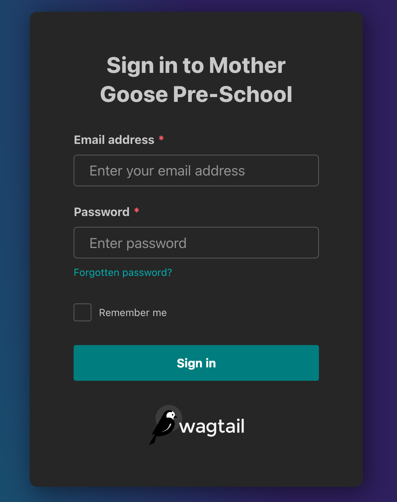

# Editing content in Wagtail

November 2026 | mkeays

## What is Wagtail?

[Wagtail](https://wagtail.org/) is the content management system our website
uses. It lets you make changes to the website and allows you to preview your
changes before you publish them.

## How do I use it?

### 1. Log in

Go to [the login page](https://www.mothergoosepreschool.co.uk/admin), and enter
your username and password to log in.

